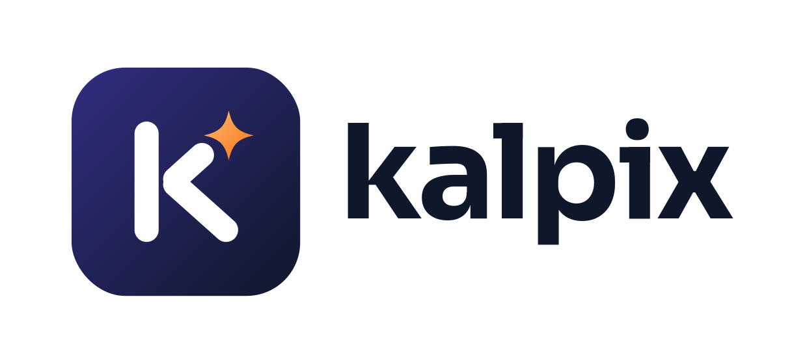

<p align="center"></p>

# Kalpix Platform

AI-powered website agency and business automation platform. Discovers local businesses, researches their real online presence, builds personalised website demos, and manages outreach, quotations, payments, delivery and maintenance with human approval at every external step.

Pilot market: Belagavi, Karnataka. Built to expand across India and internationally.

## Status

- **Phase 1** (environment and foundation): built and tested; local checks on the owner's machine still open.
- **Phase 2** (core app, database, admin dashboard): approved.
- **Phase 3** (business discovery: OSM Overpass/Nominatim, worker queue, Discovery and Businesses pages, CSV export): built and tested with the MOCK provider; live OSM data not yet verified; awaiting owner approval.
- Phase 4 has not started.

## Quick start (local)

```bash
nvm use                       # Node 22 LTS (see .nvmrc)
corepack enable               # provides pnpm
pnpm install
cp .env.example .env          # then change POSTGRES_PASSWORD and DATABASE_URL
pnpm doctor                   # inspects this machine, writes reports/environment-report.md
pnpm db:up                    # local PostgreSQL 16 in Docker (localhost only)
pnpm db:check                 # verifies the database connection
pnpm verify                   # typecheck + lint + format + tests
# then add SEED_OWNER_EMAIL / SEED_OWNER_PASSWORD to .env
pnpm db:deploy                # apply migrations
pnpm db:seed                  # providers (disabled), settings, DEMO packages, first owner
pnpm dev                      # admin at http://localhost:3000, sign in, then enable MFA
pnpm build && pnpm start      # production build; in another terminal: pnpm e2e
pnpm worker                   # discovery worker: polls the queue (WORKER_POLL_INTERVAL_MS)
pnpm worker:once              # drain the queue once and exit (CI, cron)
```

For offline testing run the app with `DISCOVERY_PROVIDER=mock pnpm start` (MOCK data, refused in production). Worker integration tests: `pnpm -F @kalpix/worker test:integration` (needs PostgreSQL).

### Discovery environment variables (Phase 3)

| Variable                  | Default                                   | Purpose                                                                 |
| ------------------------- | ----------------------------------------- | ----------------------------------------------------------------------- |
| `DISCOVERY_PROVIDER`      | `overpass`                                | `overpass`, `mock` (not in production) or `google_places` (stub)        |
| `OVERPASS_API_URL`        | `https://overpass-api.de/api/interpreter` | Overpass endpoint (point at your own instance for heavy use)            |
| `NOMINATIM_BASE_URL`      | `https://nominatim.openstreetmap.org`     | Geocoder for place names                                                |
| `NOMINATIM_CONTACT_EMAIL` | (empty)                                   | Required by the Nominatim usage policy; place names disabled without it |
| `NOMINATIM_COUNTRY_CODES` | `in`                                      | Limits geocoding to these countries                                     |
| `DISCOVERY_MAX_BBOX_DEG2` | `0.25`                                    | Largest search box in square degrees                                    |
| `WORKER_POLL_INTERVAL_MS` | `5000`                                    | Worker poll interval (min 1000)                                         |
| `GOOGLE_PLACES_API_KEY`   | (empty)                                   | Paid; stays disabled until approved                                     |

Overpass and Nominatim must also be enabled and marked commercial-use verified by the owner in AI Provider Settings.

## Repository layout

```
apps/admin        Next.js admin dashboard: auth, RBAC, MFA, audit, providers, pricing
apps/worker       background worker: discovery queue (pnpm worker / worker:once)
packages/config   validated environment config (zod), secret-safe status
packages/core     provider contracts, Result type, enable rules
packages/providers  discovery adapters: OSM Overpass, Nominatim, MOCK, Google Places stub
infra/docker      local dev services
infra/backup      database backup script
scripts           doctor (environment inspection), check-db
docs              all project documentation and brand assets
```

## Documentation

See `docs/`: business requirements, roadmap, architecture, stack, free vs paid tools, schema, API, security, deployment, cost, testing and phase reports.
